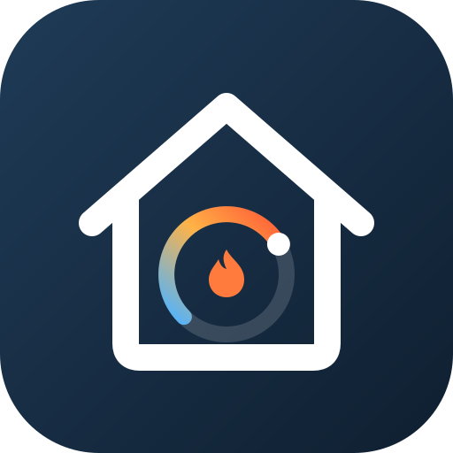

<p align="center"></p>

# Homebridge-Siemens-RDS

[](https://github.com/homebridge/homebridge/wiki/Verified-Plugins)
[](https://www.npmjs.com/package/homebridge-siemens-rds)

Homebridge plugin for Siemens RDS110 / RDS110.R / RDS120 smart thermostats. It talks to the Siemens
Climatix IC cloud (`api.climatixic.com`), which is the same backend the Siemens Smart Thermostat RDS app uses.
The API logic is ported from the openHAB `siemensrds` binding (EPL-2.0).

## Install

In the Homebridge UI: **Plugins** → search for **Siemens RDS** → **Install**. Or from the command line:

```
sudo npm install -g homebridge-siemens-rds
```

Then open the plugin settings, enter the Siemens app e-mail, password and API key (see [Getting the API key](#getting-the-api-key)), and restart Homebridge.

Requires Node.js 22, 24 or 26 and Homebridge 1.8 or 2.x.

## What HomeKit sees

One Thermostat accessory per RDS on your Siemens account:

| HomeKit | RDS |
|---|---|
| Current temperature | Room temperature (`RTemp`) |
| Humidity | Room relative humidity (`RHuRel`) |
| Target temperature (0.5° steps, 6–35 °C) | Setpoint (`SpTR`) |
| Heating / idle | Output state (`HCSta`) |
| Mode **Auto** | **Auto**: follows the RDS weekly time program (writes `REei=5`) |
| Mode **Heat** | **Manual**: holds the temperature you set and ignores the time program (writes `CmfBtn=1`) |
| Mode **Off** | **Off**: thermostat switched off (writes `OccMod=Off`) |
| Separate **"<name> Away"** switch | **Away**: on/off (writes `OccMod=Absent` / `Present`) |

### Why "Heat" means Manual, and why Away is a switch

Apple's Home app only offers four fixed thermostat modes: Off, Heat, Cool and Auto. A plugin can hide modes
(Cool is hidden here) but cannot add new ones or rename them. So:

- **Heat in the Home app = Manual in the Siemens app.** The label is set by iOS and can't be changed.
- **Away** has no matching HomeKit mode, so it is a separate switch next to each thermostat.
  Turn it off with `"awaySwitch": false`.
- Selecting Heat, Auto or Off clears Away.

Thermostats are named after the room set in the Siemens app (e.g. "Ground Floor"), unless you set a name in `devices`.

The plugin polls every 60 s by default. After any change from HomeKit it polls every 8 s for about 50 s.
If the cloud or the thermostat is unreachable, HomeKit shows "No Response" instead of stale values.

## Config

```json
{
  "platform": "SiemensRDS",
  "name": "Siemens RDS",
  "email": "you@example.com",
  "password": "your Siemens app password",
  "apiKey": "32-character Ocp-Apim-Subscription-Key",
  "pollInterval": 60,
  "devices": [
    { "plantId": "1st Floor", "name": "First floor" },
    { "plantId": "Garage", "exclude": true }
  ]
}
```

### Naming thermostats

The plugin has its own settings page in the Homebridge UI (Plugins → Siemens RDS → Settings):

1. Enter the Siemens app e-mail, password and API key.
2. The page asks the Siemens cloud and lists every thermostat on the account, one row each, with its Siemens room name.
3. Type a **Name in HomeKit** for any thermostat you want to rename, or tick **Hide**.
   Leave the name empty to keep the Siemens room name.
4. Save and restart Homebridge.

Do this **before pairing with HomeKit**. Names are set before the thermostats are published, but once paired the
Home app keeps its own names. To apply new names after pairing, rename them in the Home app, or remove the bridge
from the Home app and pair it again.

In `config.json`, entries in `devices` match a thermostat by plant ID or by Siemens room name (case-insensitive).
The startup log lists every thermostat:

```
Thermostat "1st Floor Hallway": Siemens room "1st Floor", plantId P7fb024f2-...
```

## Install from source (development)

```
git clone https://github.com/ppapajohn/Homebridge-Siemens-RDS.git
cd Homebridge-Siemens-RDS && npm install --omit=dev
sudo npm install -g "$PWD"
```

To update: `git pull && npm install --omit=dev`, then restart Homebridge.

## Getting the API key

Siemens does not publish the key. Capture it from the RDS app's traffic to `api.climatixic.com`:
use mitmproxy or Charles and look for the `Ocp-Apim-Subscription-Key` request header. You only need the key;
the plugin logs in with your e-mail and password and renews its own 14-day token.

## Logs

Run Homebridge in debug mode to see the raw values on every poll (room, target, RH, output, OccMod, PrOpModRsn priority).
